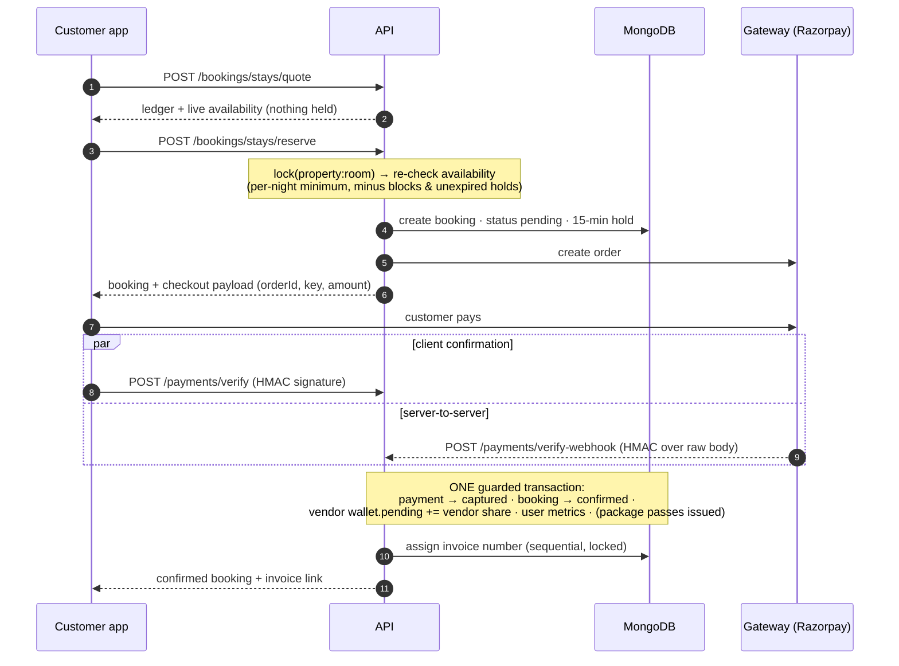
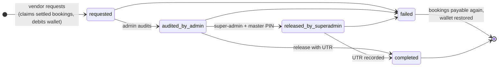

# Architecture & design decisions

This document explains *why* the backend is built the way it is, how the money and booking flows work, how each part of the spec maps to code, and
which points in the spec you should confirm with the business.

## Contents
1. [Principles](#principles)
2. [Spec → code map](#spec--code-map)
3. [MongoDB + Prisma decisions](#mongodb--prisma-decisions)
4. [Core flows](#core-flows) — booking & payment · cancellation & refund · settlement & payouts · sessions
5. [Pricing engine](#pricing-engine)
6. [RBAC matrix → implementation](#rbac-matrix--implementation)
7. [What was added beyond the spec](#what-was-added-beyond-the-spec)
8. [Spec observations (things to confirm)](#spec-observations-things-to-confirm)
9. [Testing strategy](#testing-strategy)

---

## Principles

1. **The server is the source of truth for money.** The frontend's ledger math is reproduced exactly (`Math.round(x * 0.08)` shape, same step order), but every charge is computed server-side from `PlatformConfig`; the UI should call `POST /bookings/*/quote`.
2. **Never lose or double-apply money.** State changes that move money use *guarded transactions*: the first operation of an atomic batch is a conditional update (`where: { id, status: { in: [...] } }`). If the guard no longer matches, the whole batch rolls back. This makes webhooks, client retries, background jobs and double-clicks idempotent without in-memory flags.
3. **Database first, gateway second.** On refunds the DB records the decision (and a `pending_…` refund record) inside the transaction, *then* the gateway is called; a job retries anything the gateway didn't accept.
4. **Pure engines, thin services.** Anything arithmetic (pricing, cancellation, availability, payouts) is a pure function in an `*.engine.ts` file — unit-tested without a database.
5. **Least privilege, auditable.** Five separate identities; staff permissions are loaded live on every request; secrets are encrypted at rest; sensitive staff actions go to an audit log with secrets stripped.
6. **Stable API shape, clean storage.** The spec's response shapes (including duplicated alias fields like `price`/`numericPrice`/`inrPrice`, `host`/`hostName`) are produced by **presenters**; the database stores each fact once.

---

## Spec → code map

| Spec section | Implemented in |
| :-- | :-- |
| §2.1–2.5 Actor models | `prisma/schema.prisma` (`User`, `Vendor`, `SubAdmin`, `Admin`, `SuperAdmin`) · `modules/auth` · `modules/staff` · `modules/vendors` · `modules/users` |
| §2.6 RBAC matrix | `middlewares/{authenticate,staff,vendor,masterPin}.ts` — see [table below](#rbac-matrix--implementation) |
| §3.1 Property | `modules/properties` (+ `inventory` for room availability / blocks) |
| §3.2 Package | `modules/packages` |
| §3.3 Experience | `modules/experiences` (+ `inventory` for slot availability) |
| §3.4 Ad campaigns | `modules/ads` |
| §4.1–4.3 Bookings & pricing | `modules/bookings` — `pricing.engine.ts`, `stay/package/experience.booking.service.ts` |
| §4.4 Payment & invoice | `modules/payments` — `payment.service.ts` (capture/webhook), `invoice.service.ts` (GST invoice PDF) |
| §4.5 Vendor payouts | `modules/payouts` + `modules/admin/{finance.admin,superadmin.routes}.ts` |
| §5.1 Reviews | `modules/reviews` |
| §5.2 Wishlist | `modules/wishlist` |
| §5.3 Audit log | `services/audit.service.ts` · `GET /superadmin/audit-logs` |
| §6 Field dictionary | `*.presenter.ts` (aliases) · `prisma/schema.prisma` |
| §7 Indexing | `@@index` in the schema · `scripts/create-indexes.ts` (partial unique, TTL, geo) |
| §8 Roadmap phases 1–7 | all implemented; phase 8: tests ✔, k6 load test ✘ (see README checklist) |
| §9 Endpoint inventory | all **42** listed endpoints exist at the same paths (+142 more) — `docs/ENDPOINTS.md` |

---

## MongoDB + Prisma decisions

| Decision | Why |
| :-- | :-- |
| **Prisma 6.19** (not 7/8) | Prisma 7 ships no MongoDB connector; Prisma 8's MongoDB support is a different API at release-candidate stage. 6.19 is the stable, documented path for `schema.prisma` + MongoDB. |
| **Replica set required** | Prisma uses transactions internally on MongoDB, and this codebase relies on atomic batches. `docker-compose.yml` starts a single-node replica set. |
| **Composite types** for embedded documents (rooms, tiers, itinerary, ledgers…) | Matches the spec's document shapes; typed and filterable (`rooms`, `address: { is: { lat: … } }`). |
| **Counters as top-level fields** (vendor wallet, ad stats, user metrics, review votes) | Atomic `increment` is only guaranteed on top-level fields; presenters re-nest them (`wallet`, `metrics`, `budget`) to match the spec. |
| **No `@unique` on optional fields** | Prisma creates a *non-sparse* unique index, so only one document could ever lack the field. `phone`, `invoiceNumber`, `gatewayPaymentId`, `authProviderId` get **partial unique indexes** from `npm run db:indexes`. |
| **TTL indexes** for `refresh_tokens` and `one_time_codes` | MongoDB deletes expired rows itself. |
| **Search = `contains` + tag/amenity arrays** | No Atlas Search dependency. `amenityKeys` (lower-cased, derived) makes amenity filters index-friendly (`hasEvery`). Atlas Search is the upgrade path for fuzzy / relevance ranking. |
| **"Near me" = bounding box + haversine** | Works without a `2dsphere` index and is exact at city scale. For millions of rows switch to `$geoNear` via `aggregateRaw`. |
| **Dates as `YYYY-MM-DD` strings (IST)** for stays / activities | Calendar dates have no timezone; string comparison is correct for ISO dates and keeps availability queries simple. Instants (`createdAt`, `holdExpiresAt`) are real `DateTime`s. |
| **Money = integer rupees** | The spec's ledger rounds to whole rupees at each step; integers avoid float drift in sums. |
| **Sequences via `findAndModify`** | `MHA-2026-0001`, `INV-2026-00001`, `USR-10001`… come from an atomic counter collection. Invoice numbers are allocated *after* a successful capture, under a per-payment lock, so duplicate webhooks never burn numbers. |
| **`PlatformConfig` singleton collection** | The spec embeds `platformConfig` in `SuperAdminModel`; pricing shouldn't depend on which super-admin account saved it last. Cached 30 s. |

---

## Core flows

### 1 · Booking & payment



* **Whichever of verify / webhook arrives first wins; the other is a no-op** (the guard fails → "already processed").
* **Hold expiry:** a job cancels unpaid bookings after `BOOKING_HOLD_MINUTES`. If the customer pays *after* that (or in the same millisecond), the capture handler sees a cancelled booking and **refunds automatically** (`HOLD_EXPIRED_REFUNDED`).
* **Reuse of holds:** re-sending an identical `reserve` returns the same checkout instead of a second hold. A user can have at most 5 unpaid holds (anti-hoarding).
* **Statuses** — stay: `pending → confirmed → checked_in → checked_out` (+ `cancelled`, `no_show`); package: `pending → confirmed → completed`; experience: `pending → reserved → checked_in → completed`. (`pending` and `no_show` are additions — the spec jumps straight to paid states.)
* **Auto-completion:** past-dated bookings are completed by a job, which releases the vendor's money and enables reviews.

### 2 · Cancellation & refunds

`cancellation.engine.ts` (pure, unit-tested):

| Who cancels | When | Refund |
| :-- | :-- | :-- |
| Customer | ≥ N h before start (default 48, property can override) | 100% |
| Customer | inside the window, before start | 100% − late fee (default 50% of the booking total) |
| Customer | after start / no-show | 0% |
| Vendor, admin, system | any time | 100% |
| Admin override | any time | exact amount (capped at what was paid); sub-admins are capped by `maxRefundCeilingInr` |

Execution order: **(1)** one guarded transaction — booking `cancelled`, vendor wallet reversed (and the vendor's share of any retained penalty credited as *available*), customer metrics, payment marked refunded with a `pending_…` refund record; **(2)** gateway refund call (idempotency key = the pending id); **(3)** record the real refund id — or leave it `initiated` for the **retry job**.
`GET /bookings/:type/:id/cancellation-preview` shows the customer exactly what they'd get back.

### 3 · Settlement & payouts



* **Wallet:** payment captured → `pending`; service delivered → `available`; payout requested → debited from `available`; completed → lifetime totals updated.
* **Eligibility:** settled bookings (checked-out / completed / no-show, or cancelled-with-penalty), not already in a payout, service date ≤ *today − holdDaysAfterService* (default 2), vendor bank **verified**, net ≥ `minPayoutAmountInr`.
* **Math:** per booking `commission` is taken on the **pre-GST taxable value**; `net = Σ(paid − commission) − TDS`, where TDS = `tdsRatePercent` × taxable value. All rates come from `PlatformConfig` (per-vendor commission overrides: `PUT /superadmin/vendors/:id/commission`, applies to future bookings only — each booking stores a snapshot).
* **Concurrency:** payout requests are serialised per vendor, bookings are *claimed* with a conditional `updateMany` (count must match), and the wallet debit is guarded by `walletAvailableInr ≥ amount`.

### 4 · Sessions & identity

* **Access token** JWT (HS256, 15 min, issuer/audience pinned) · **refresh token** opaque, stored hashed, rotated each use, same *family*; replaying a rotated token revokes the whole family (a 10-second race window avoids logging out two tabs that refresh together).
* **Brute-force:** per-account lockout (5 failures → 15 min) plus IP rate limits; unknown e-mails still run a bcrypt compare so response time doesn't reveal accounts.
* **Staff 2FA:** password → short-lived challenge token → TOTP (RFC 6238) or, for the super-admin, a one-time recovery key. Optional IP allow-lists per admin.
* **Secrets at rest:** vendor bank account numbers and 2FA secrets use AES-256-GCM (`ENCRYPTION_KEY`); the master PIN and passwords are bcrypt hashes.
* **CSRF:** the refresh cookie is `HttpOnly`, path-scoped to `/api/v1/auth`, `SameSite` (configurable), and `/auth/refresh` + `/auth/logout` reject foreign `Origin`s.

---

## Pricing engine

`modules/bookings/pricing.engine.ts`, all rates from `PlatformConfig` (Super-Admin editable, effective immediately, cached 30 s):

```
STAY        base = Σ nightly rate × rooms          cleaning = round(1-night price × 5%) × rooms
            discount = round(base × 8%)  [club members]
            taxable = base − discount + cleaning    GST = round(taxable × 18%)    total = taxable + GST

PACKAGE     base = adults × tier price + children × (child price | 60% of tier) [+ weekend surcharge]
            discount = round(base × 8%)             taxable = base − discount     GST 5%

EXPERIENCE  base = adults × price + children × 70% × price
            discount = round(base × 8%)             gear insurance = round(price × 4%) × participants
            taxable = base − discount + gear        GST 5%
```

Checked against the spec's examples in `tests/pricing.test.ts`: stay **₹18,237**, package **₹22,218**, experience **₹706**.
`dynamicPricing.enabled` (default **off**, so numbers match the frontend) switches on weekend/holiday nightly rates and the package weekend surcharge.
GST is split CGST+SGST (intra-state) or IGST (inter-state, using the customer's `billingState`) on the invoice.

---

## RBAC matrix → implementation

| Spec row | Enforced by |
| :-- | :-- |
| Browse catalog (everyone) | public routers |
| Create booking / pay (User only) | `requireRole('user')` on `/bookings/*/reserve`, `/payments/*` |
| Manage own profile / wishlist (User) | `requireRole('user')` |
| Submit listing (Vendor, Admin, Super) | `requireApprovedVendor()` on `/vendor/*` writes |
| Publish listing (Admin approves; Vendor pending) | listings start `pending_approval`; `PATCH /admin/{properties,packages,experiences}/:id/status` needs `canApproveProperties` / `canApprovePackages` / `canApproveExperiences` |
| Manage room inventory & block dates (Vendor own) | `/vendor/properties/:id/blocks`, `/calendar` (ownership checked; 404 on others' ids) |
| View customer phone/email (Vendor scoped · Sub-admin masked · Admin full) | `booking.presenter` contact modes: vendors see contact only for paid bookings; sub-admins get masked values |
| Moderate reviews (Sub-admin review · Admin approve/delete) | `sub_admin[canApproveReviews]` to moderate; delete is admin-only |
| Approve vendor KYC / bank (Admin) | `admin[canApproveVendors]`; sub-admin read-only; bank numbers only with `canViewVendorBankDetails` (audited) |
| Release payouts (Super-Admin; Admin audit only) | `/admin/finance/*` audit (`canExportFinancialReports`) · `/superadmin/finance/payouts/*` + master PIN |
| Create sub-admins (Admin assign; Super full) | `admin[canManageSubAdmins]` (own sub-admins only) · `/superadmin/subadmins` (any) |
| Modify GST / commission % (Super-Admin only) | `PUT /superadmin/config`, `PUT /superadmin/vendors/:id/commission` + master PIN |

Support-staff refund limits: `canInitiateCustomerRefunds` + `maxRefundCeilingInr` (refunds above the ceiling are refused with `REFUND_CEILING_EXCEEDED`).

---

## What was added beyond the spec

**Money & operations:** cancellation/refund engine + preview · hold expiry and late-capture auto-refund · refund retry job · invoice PDF (GST breakup, SAC) · vendor wallet lifecycle · payout hold period · availability calendar and date/slot blocks (weather closures) · check-in/out/no-show actions · voucher redemption for bundled activities · dashboards (vendor, admin, super-admin).
**Security:** refresh-token rotation + reuse detection · account lockout · TOTP 2FA with recovery keys · master PIN · AES-GCM at rest · IP allow-lists · CSRF origin guard · Zod validation everywhere · audit log with secret redaction.
**Accounts:** phone-OTP login · Google sign-in · e-mail verification · password reset · account deletion (soft).
**Developer experience:** Docker (replica-set MongoDB, Redis, API image) · mock payment gateway · seed script · generated endpoint docs + Postman collection · `GET /config/public` · health / readiness probes · structured logs with request ids · graceful shutdown.

---

## Spec observations (things to confirm)

These are places where the spec is ambiguous or internally inconsistent. The implementation made a choice; please confirm each one.

1. **Package price: per person or per couple?** Cards say *"From ₹11,500 / couple"*, but the booking ledger computes `pricePerPerson × adults` (= ₹23,000 for 2 adults). The API follows the **ledger** and labels prices `/ person` (`pricingUnit: "person"`). If a couple really pays ₹11,500, the tier price/ledger must change.
2. **Package rating `"4.7/10 ★"`** looks like a typo (everything else is out of 5). The API emits `4.7/5 ★` plus numeric `ratingScore`.
3. **Cleaning fee** — the field dictionary says "5% … calculated on base stay", the booking formula says `round(pricePerNight × 5%)` (one night's price). The **formula** is implemented (multiplied by rooms).
4. **GST on stays** — the spec uses a flat 18%. Indian hotel-room GST has historically been *slab-based* on the nightly tariff and the slabs have been revised. The rate is a config value, but only one rate per category is supported; if your tariff spans slabs, extend `calculateStayPricing`. **Please have your CA confirm** rates and SAC codes (`996311`, `998555`).
5. **TDS "1% under 194-O"** — the section, rate and base for e-commerce TDS have been revised in recent years. It is a config value (`payoutRules.tdsRatePercent`, applied to the pre-GST value); **confirm the current rule with your CA**.
6. **Who remits GST?** The spec's invoice lists the *vendor's* GSTIN, so the implementation treats the vendor as the supplier of record: the vendor is paid the customer's total minus our commission (commission is charged on the pre-GST value). If the platform should collect/remit GST itself, the settlement math in `payout.engine.ts` changes.
7. **IDs like `p5001`, `pkg1001`, `act1001`, `r501`** in the spec are frontend mock data. Real ids are MongoDB ObjectIds (24 hex). Properties/packages/experiences can also be fetched by `slug`; **room ids, tier ids and slot ids stay human-chosen strings** (`r501`, `couple-standard`, `slot-sunrise`).
8. **Booking statuses** — the spec has no unpaid/hold state or `no_show`; `pending` and `no_show` were added. The spec's payment status for stays includes `partially_refunded`; it was added for packages/experiences/payments too.
9. **Free-activity vouchers** — one pass per bundled activity per booking (not per person), issued only after payment, redeemable only while the trip is running.
10. **Packages vs. room inventory** — see "Known gaps" in the README: packages don't currently reserve rooms.
11. **Support tickets** — `canManageInquiryTickets` exists in the spec but no ticket model/endpoints do (README → Known gaps).
12. **`SuperAdminModel.platformConfig`** was moved to its own collection (see above), and `wallet` / `metrics` are stored as top-level counters but returned nested, exactly as in the spec.

---

## Testing strategy

| Layer | What | Where |
| :-- | :-- | :-- |
| Pure engines | pricing (spec numbers), cancellation matrix, per-night availability, payout math, TOTP (RFC 6238 vectors), crypto, dates | `tests/{pricing,cancellation,availability,payout,totp,utils}.test.ts` |
| Whole-app HTTP | the entire Express app boots with Prisma mocked; auth, lockout, refresh rotation & reuse detection, CSRF guard, RBAC (every role/route class), raw-body webhook signatures, CORS, validation errors, catalog query wiring | `tests/app.smoke.test.ts` |
| Contracts | the spec's sample payloads (HillView, trek, anniversary package…) validate against the API schemas, and typical client mistakes are rejected | `tests/seed.data.test.ts` |
| Not yet covered | real-database integration (transactions, guarded updates, indexes) and load tests — the first things to add; use a `MongoMemoryReplSet`, then k6 for the 1,000-concurrent-reservation target | — |
